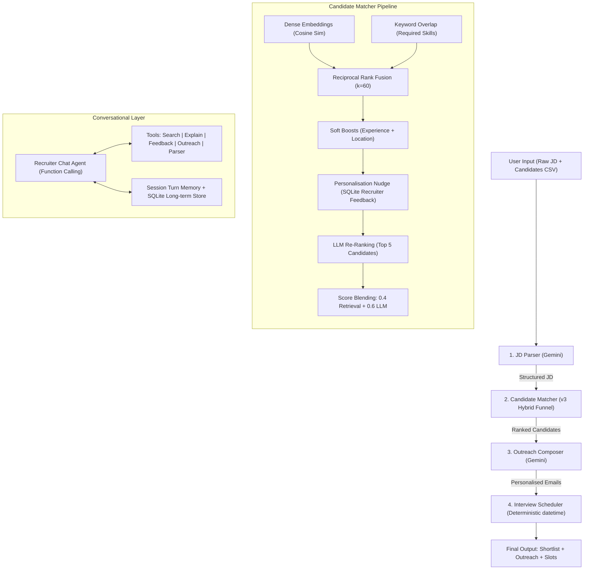

# HireFlow — Multi-Agent Recruitment & Talent Retrieval Pipeline

[](https://github.com/koi-bito/HireFlow/actions/workflows/ci.yml)
[](https://fastapi.tiangolo.com)
[](https://langchain-ai.github.io/langgraph/)
[](https://ai.google.dev)
[](https://www.python.org/)

> A production-grade multi-agent recruitment system built with **LangGraph**, **Google GenAI (Gemini 3.5 Flash)**, and **FastAPI**. Features two-tower hybrid retrieval (dense vector embeddings + keyword overlap via Reciprocal Rank Fusion), recruiter feedback personalisation, an autonomous tool-calling recruiter chatbot, and an offline evaluation harness.

---

## Architecture



---

## Benchmark Evaluation Results

Evaluated over the committed benchmark dataset (**8 Job Descriptions × 60 Candidate Profiles = 480 Graded Relevance Annotations**):

| Retrieval Mode | P@5 | P@10 | R@5 | R@10 | MRR | NDCG@5 | NDCG@10 | Groundedness | Avg Latency | LLM Calls/Run |
|---|---|---|---|---|---|---|---|---|---|---|
| **keyword** | 1.0000 | 0.7750 | 0.3857 | 0.5683 | 1.0000 | 0.9878 | 0.9517 | 100.0% | 8.1 ms | 0.0 |
| **embedding** | 1.0000 | 0.8250 | 0.3857 | 0.6049 | 1.0000 | 0.9769 | 0.9574 | 100.0% | 29.8 ms | 0.0 |
| **hybrid** | 0.9500 | 0.8000 | 0.3678 | 0.5842 | 0.8750 | 0.8760 | 0.8980 | 100.0% | 30.1 ms | 0.0 |
| **hybrid + LLM** | 0.9750 | 0.8000 | 0.3779 | 0.5842 | 1.0000 | 0.9586 | 0.9421 | 100.0% | 30.2 ms | 1.0 |

> *Notice: Dataset annotations are synthetic for benchmark purposes. See [evals/dataset/README.md](evals/dataset/README.md) for calibration requirements.*

---

## Five Specialised Agents

1. **JD Parser (`agents/jd_parser.py`)**: Prompts Gemini 3.5 Flash to extract structured role attributes (title, required skills, preferred skills, experience, location, employment type) with strict JSON output and safe fallbacks.
2. **Candidate Matcher (`agents/candidate_matcher.py`)**: Two-stage retrieval funnel:
   - Stage 1: Dense semantic search (`CandidateIndex`) + sparse keyword overlap combined via Reciprocal Rank Fusion (RRF: $k=60$).
   - Stage 2: Soft boosts for seniority and location, recruiter feedback personalisation ($\pm 0.08$), and batched LLM re-ranking for the top 5 candidates.
   - Grounded Explainability: Reasons cite verified skills from candidate profiles (100% groundedness).
3. **Outreach Composer (`agents/outreach_composer.py`)**: Generates warm, human, personalised recruiter outreach messages under 200 words citing specific strengths.
4. **Interview Scheduler (`agents/interview_scheduler.py`)**: Computes 3 real next-business-day interview slots deterministically via Python `datetime` (zero date hallucinations).
5. **Recruiter Chat Agent (`agents/recruiter_chat.py`)**: Interactive conversational agent using function calling across 5 recruitment tools with turn budgeting and long-term feedback memory.

---

## Quickstart

### 1. Local Setup

```bash
git clone https://github.com/koi-bito/HireFlow.git
cd HireFlow
pip install -r requirements.txt
cp .env.example .env
# Add your GOOGLE_API_KEY to .env
```

Start the API server:
```bash
uvicorn app:app --reload --port 8000
```
Interactive API documentation: `http://localhost:8000/docs`

### 2. Docker Setup

```bash
docker compose up --build
```
The API is exposed at `http://localhost:8000` with automated healthchecks and persisted storage volumes for SQLite and embedding caches.

---

## API Usage & Endpoints

### 1. Health Check
```bash
curl http://localhost:8000/health
```
```json
{
  "status": "ok",
  "timestamp": "2026-11-22T09:20:06Z",
  "version": "3.0.0",
  "database": "ok",
  "embedding_model": "models/gemini-embedding-001"
}
```

### 2. Run Full Multi-Agent Pipeline
```bash
curl -X POST http://localhost:8000/run \
  -H "Content-Type: application/json" \
  -d '{
    "job_description": "We are seeking a Senior ML Engineer with 5+ years of experience in Python, PyTorch, FastAPI, and Docker. Remote. Full-time."
  }'
```

### 3. Retrieve Historical Run (Survives Restarts)
```bash
curl http://localhost:8000/results/{run_id}
```

### 4. Record Recruiter Feedback (Personalisation)
```bash
curl -X POST http://localhost:8000/feedback \
  -H "Content-Type: application/json" \
  -d '{
    "candidate_email": "alice@example.com",
    "job_title": "Senior ML Engineer",
    "action": "shortlisted",
    "run_id": "run-uuid-here"
  }'
```

### 5. List Runs with Pagination
```bash
curl "http://localhost:8000/runs?limit=10&offset=0"
```

### 6. Interactive Recruiter Chat (Tool Use & Memory)
```bash
curl -X POST http://localhost:8000/chat \
  -H "Content-Type: application/json" \
  -d '{
    "message": "Find top candidates for Senior ML Engineer",
    "session_id": "session-101"
  }'
```

---

## Running Tests & Evals

### Run Unit & Integration Tests (100% Offline)
```bash
pytest -q
```
*92 tests passed in ~6 seconds with zero network calls.*

### Run the Evaluation Benchmark
```bash
python -m evals.run_eval --ci
```

---

## Engineering Design & Interview Notes

See [docs/DESIGN.md](docs/DESIGN.md) for deep technical explanations covering:
- Why Hybrid RRF retrieval beats pure keyword or pure vector search.
- The mathematics of Reciprocal Rank Fusion ($k=60$).
- Why plain NumPy matrix search ($A \times B^T$) is faster and more reliable than FAISS for $<50,000$ candidates.
- Scaling from 50k to 1,000,000+ candidates (HNSW, Vector Databases, Kafka queues).
- Top 5 interview questions and candidate matching tradeoffs.
